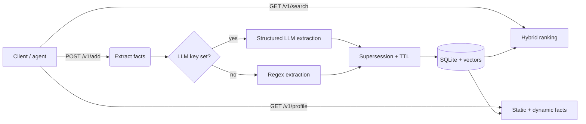

# Recall — self-hosted AI memory infrastructure

Recall is a small, self-contained memory engine for AI applications: it ingests raw
text, extracts durable and temporary facts, keeps them consistent over time (supersession
and expiry), and serves them back through hybrid semantic search and a user profile.

It is *memory infrastructure*, not a chatbot. A consuming agent or app calls Recall to
store what it learns and to retrieve relevant context, then uses that context when
generating a response.

The whole loop runs locally with **no external services or cloud keys required** for the
default path — local embeddings, a regex extractor fallback, and a single SQLite file.
Optional provider keys upgrade embeddings and extraction to hosted models.



## Why it exists

Hosted "memory" APIs make the core mechanics invisible. Recall implements the same
mechanics end-to-end in readable code so they can be studied, extended, and self-hosted:

- **Structured fact extraction** — an LLM (OpenAI / Anthropic / Gemini) emits typed facts
  through a JSON schema; a deterministic regex extractor keeps the app working offline.
- **Memory lifecycle** — slot-based supersession resolves contradictions ("I live in
  Berlin" → "I now live in Lisbon") and temporal keywords give temporary facts a TTL.
- **Semantic retrieval** — local `bge-base-en-v1.5` embeddings power hybrid search over
  both memories and the raw source documents.
- **Persistence** — a transactional SQLite backend (WAL) with explicit schema migrations
  and embeddings stored alongside each row.
- **Document ingestion** — upload `.txt`/`.md`/`.pdf`; files are validated, stored privately,
  chunked (PDF page-aware) and made searchable with provenance back to the source passage.
- **Tenant-scoped API access** — hashed, scoped API keys with container ownership enforced
  in the data layer.

## Architecture

```
server.js                 Express app: routes, auth, tenant isolation, limits, shutdown
lib/auth.js               API-key issuance/hashing, auth middleware, container authorization
lib/validate.js           request / identifier / container / payload-size validation
lib/ratelimit.js          in-memory per-key rate limiter
lib/db.js                 compatibility shim → lib/storage
lib/storage/index.js      backend selection + facade (STORAGE_BACKEND)
lib/storage/sqlite.js     SQLite backend (better-sqlite3, WAL, transactions, indexes)
lib/storage/json.js       legacy JSON backend (kept for rollback)
lib/storage/migrations/   explicit SQL schema migrations (001 storage, 002 auth, 003 documents)
lib/storage/vectors.js    embedding encode/decode + validation
lib/documents/            upload pipeline: storage, extract (txt/md/pdf), chunk, ingest
lib/extract.js            orchestrates LLM vs regex; applies slot/TTL mechanics
lib/extract/              openai / anthropic / gemini structured extractors + regex
lib/embeddings/           xenova (default) / openai / gemini / tfidf
lib/search.js             hybrid ranking over stored vectors
lib/tfidf.js              TF-IDF fallback scorer
public/                   vanilla HTML/CSS/JS dashboard (API-key field + authenticated calls)
scripts/                  key CLI, JSON→SQLite migration, and evaluation scripts
test/                     node:test regression suite
```

## How a memory flows through Recall

1. **Ingest** — `POST /v1/add` accepts raw text and stores the source document.
2. **Extract** — the text is classified into typed facts. With a provider key, an LLM
   returns structured JSON; otherwise the regex extractor runs. Each fact becomes a memory.
3. **Persist** — document and memories are written in a single transaction, with embeddings
   attached when the embedding provider is dense.
4. **Resolve** — a new fact in an existing *slot* (location, employer, editor, …) supersedes
   the older one; dynamic facts get an expiry derived from temporal keywords and are
   filtered out on read once expired.
5. **Retrieve** — `GET /v1/search` ranks memories + documents by vector cosine similarity
   (or TF-IDF when no dense provider is available); `GET /v1/profile` returns static
   (durable) and dynamic (temporary) facts.

## How a document flows through Recall

`POST /v1/documents/upload` ingests a file (`.txt`, `.md`, `.pdf`) and makes its text
searchable at passage granularity:

1. **Validate** — filename, extension, declared content type and magic bytes must agree; size,
   page count, extracted length and chunk count are all bounded. Anything else is rejected.
2. **Deduplicate** — the SHA-256 of the bytes identifies an identical, already-processed upload
   in the same container; it returns the existing document and creates no new chunks.
3. **Extract** — text is pulled per page for PDFs (via `unpdf`) and normalized; parsing has a
   wall-clock timeout and a page cap.
4. **Chunk** — text is split into overlapping passages (paragraph/sentence-aware) with character
   offsets and, for PDFs, the page number.
5. **Embed** — chunks are embedded in batches when a dense provider is configured; embedding is
   best-effort and a failure leaves the chunk lexically searchable rather than lost.
6. **Persist** — the document row and its chunks are written in one transaction after the file
   is committed to private storage; any failure removes the file and records a `failed` row.
7. **Retrieve** — chunks appear in `/v1/search` results with `source: "chunk"`, `documentId`,
   `filename` and `page`, so every hit is traceable to its source document and passage.

Fact extraction from an upload is **off by default**. Add `?extractFacts=true` to derive
memories, which are then attributed to the source document (`documentId`) and removed with it.

## Quick start

```bash
npm install

# Bootstrap your first API key (offline CLI — shown once, then hashed):
npm run key:create -- --tenant alice --container my_space
#   API key created. This secret is shown ONCE — store it now.
#     sm_…
#     tenant:    alice
#     container: my_space

npm start
# open http://localhost:6767 and paste the key into the "api key" field
```

Requires **Node.js >= 22** (developed and tested on Node 23.11; the PDF extractor `unpdf`
targets Node 22+). Data is stored in SQLite by default (`data/recall.db`), and uploaded files
under `data/uploads/`.

On the first request with the default embedding provider, `bge-base-en-v1.5` (~100 MB) is
downloaded and cached. After that, search is local and key-free.

## Configuration

Copy `.env.example` to `.env` (never commit it) and adjust. Everything has a working
default; the variables below are the full surface.

| Variable | Default | Purpose |
|---|---|---|
| `PORT` | `6767` | HTTP port. |
| `DATA_DIR` | `./data` | Base directory for the database. |
| `STORAGE_BACKEND` | `sqlite` | `sqlite` (default) or `json` (legacy/rollback). |
| `SQLITE_FILE` / `STORE_FILE` | `data/recall.db` / `data/store.json` | Explicit file paths. |
| `AUTH_MODE` | `required` | `required`, or `dev` for a local single-tenant bypass. |
| `DEV_TENANT` / `DEV_CONTAINER` | `dev` / `dev` | Tenant/container used in `dev` mode. |
| `RATE_LIMIT_PER_MIN` | `120` | Per-key overall request budget. |
| `RATE_LIMIT_EXPENSIVE_PER_MIN` | `30` | Budget for embedding/LLM operations. |
| `CORS_ORIGINS` | *(off)* | Explicit comma-separated allowlist. Never a wildcard. |
| `EMBEDDINGS_PROVIDER` | `xenova` | `xenova` \| `openai` \| `gemini` \| `tfidf`. |
| `EMBEDDINGS_MODEL` | provider default | Override the embedding model id. |
| `EMBEDDINGS_DTYPE` | `q8` | Local precision. Changing it changes the vector space (stale vectors are re-embedded on access; run `npm run embeddings:reindex`). |
| `EMBEDDINGS_CACHE_DIR` | *(inside `node_modules`)* | Durable model cache directory (survives `npm ci`). |
| `EMBEDDINGS_LOCAL_MODEL_PATH` | *(unset)* | Load models from a local directory (offline installs). |
| `EMBEDDINGS_OFFLINE` | `false` | Never fetch models from the network. |
| `EXTRACTION_PROVIDER` | `auto` | `auto` \| `openai` \| `anthropic` \| `gemini` \| `regex`. |
| `EXTRACTION_MODEL` | provider default | Override the extraction model id. |
| `OPENAI_API_KEY` / `ANTHROPIC_API_KEY` / `GEMINI_API_KEY` / `GOOGLE_API_KEY` | *(empty)* | Provider credentials. |
| `UPLOAD_DIR` | `DATA_DIR/uploads` | Private directory for uploaded files (dirs `0700`, files `0600`). |
| `MAX_UPLOAD_BYTES` | `10485760` (10 MiB) | Hard cap on a single uploaded file. |
| `MAX_PDF_PAGES` | `500` | Reject PDFs with more pages. |
| `PDF_EXTRACT_TIMEOUT_MS` | `20000` | Wall-clock bound on PDF parsing. |
| `MAX_EXTRACTED_CHARS` | `2000000` | Reject documents that extract more text than this. |
| `CHUNK_SIZE` / `CHUNK_OVERLAP` | `1200` / `200` | Chunking window and overlap (characters). |
| `MAX_CHUNKS` | `2000` | Reject documents that produce more chunks. |
| `EMBED_BATCH_SIZE` | `64` | Chunks embedded per batch. |

### API-key bootstrap

There is deliberately **no unauthenticated HTTP admin endpoint**. Use the offline CLI,
which talks to the same database:

```bash
# The first key: name a tenant and a container (the container is created/claimed).
npm run key:create -- --tenant alice --container demo_user --name "alice laptop"

# Existing-data migration: adopt a pre-existing container tag.
#   e.g. if your old tags were user_123 / demo_user, create keys with those --container values.
```

## Authentication and multi-tenancy

All `/v1` endpoints require a bearer API key:

```
Authorization: Bearer sm_…
```

- **Keys are hashed, never stored raw.** A key is `sm_` + 32 random bytes; only its SHA-256
  hash is persisted. The raw secret is shown **once**, when you create it.
- **Scoped keys.** Each key maps to exactly one `tenant` and one default `container`. The
  container named in a request (`?containerTag=…`) is a *selector*, never proof of ownership:
  you can only touch containers your tenant owns. Supplying a container that belongs to
  another tenant returns `403`, and so does a container you have never written to.
- **Ownership is enforced in the data layer** (`lib/storage`), not just in the routes, so a
  query cannot accidentally span containers.
- `/v1/containers` is authenticated and only ever returns *your* containers.

### Rotation and revocation

```bash
# List keys for a tenant (ids, container, created/last-used, revoked state — never the secret)
npm run key:list -- --tenant alice

# Create an additional key for the same tenant (rotation: issue new, then revoke old)
npm run key:create -- --tenant alice --container my_space

# Revoke by key id, or by presenting the raw key
npm run key:revoke -- --tenant alice --id key_xxx
npm run key:revoke -- --tenant alice --key sm_xxx
```

Revocation is immediate and tenant-scoped (one tenant can never revoke another's key).
Revoked and expired keys return `401`. A key may be created with `--expires 2027-01-01T00:00:00Z`.

### Local development mode

For local scripting without a key you may explicitly opt in:

```bash
AUTH_MODE=dev DEV_TENANT=dev DEV_CONTAINER=dev npm start
```

Dev mode maps **every** unauthenticated request to a single configured tenant/container and
prints a loud warning. It refuses to start when `NODE_ENV=production`. It is off unless you
set it — authentication is never silently bypassed.

### Rate limiting

Per-key request limits are enforced **in memory, in a single process** (defaults:
`RATE_LIMIT_PER_MIN=120` overall, `RATE_LIMIT_EXPENSIVE_PER_MIN=30` for the embedding/LLM
operations: `POST /v1/add`, `GET /v1/search`, and `GET /v1/profile` when a `q` is supplied).
Exceeding a limit returns `429` with a `Retry-After` header. Counters are not shared across
processes — see [Limitations](#limitations).

### CORS

CORS is **off by default** (the bundled dashboard is same-origin). To allow browser clients
from other origins, set an explicit allowlist — never a wildcard:

```bash
CORS_ORIGINS=https://app.example.com,https://admin.example.com npm start
```

## API

All endpoints require `Authorization: Bearer <key>`. `containerTag` is an optional selector
that must name a container your tenant owns; if omitted, the key's default container is used.
There is no implicit `demo_user` default.

```bash
KEY=sm_…   # from `npm run key:create`

# Add content — facts get extracted automatically
curl -X POST localhost:6767/v1/add -H "Authorization: Bearer $KEY" -H "Content-Type: application/json" \
  -d '{"content":"I am a backend engineer. I live in Berlin. I prefer Rust over Go.","containerTag":"user_123"}'

# Hybrid search (memories + documents). searchMode: hybrid | memories | documents
curl -H "Authorization: Bearer $KEY" "localhost:6767/v1/search?q=where+does+the+user+live&containerTag=user_123&searchMode=hybrid"

# User profile: static (durable) + dynamic (temporary) facts
curl -H "Authorization: Bearer $KEY" "localhost:6767/v1/profile?containerTag=user_123"

# All memories, including superseded/expired ones (for transparency/debugging)
curl -H "Authorization: Bearer $KEY" "localhost:6767/v1/memories?containerTag=user_123"

# Forget a memory
curl -X DELETE -H "Authorization: Bearer $KEY" "localhost:6767/v1/memories/<id>?containerTag=user_123"

# Upload a document (.txt | .md | .pdf). Raw body; the original name is metadata only.
curl -X POST localhost:6767/v1/documents/upload \
  -H "Authorization: Bearer $KEY" \
  -H "Content-Type: text/markdown" \
  -H "X-Recall-Filename: notes.md" \
  --data-binary @notes.md
# -> 201 { duplicate:false, document:{ id, source:"upload", filename, mediaType, pageCount, status:"ready", ... }, chunkCount, memoriesExtracted:0 }

# Optional: also extract memories from the upload (attributed to the document)
curl -X POST "localhost:6767/v1/documents/upload?extractFacts=true&containerTag=user_123" \
  -H "Authorization: Bearer $KEY" -H "Content-Type: application/pdf" \
  -H "X-Recall-Filename: resume.pdf" --data-binary @resume.pdf

# Document metadata + its searchable chunks
curl -H "Authorization: Bearer $KEY" "localhost:6767/v1/documents/<id>?containerTag=user_123"

# Uploaded content is searchable; chunk hits carry provenance
curl -H "Authorization: Bearer $KEY" "localhost:6767/v1/search?q=rockets&containerTag=user_123&searchMode=documents"
# -> results: [{ source:"chunk", documentId:"…", chunkIndex:3, page:2, filename:"report.pdf", score, text }, …]

# Delete a source: removes the document, its chunks, its stored file and only
# the memories derived from it
curl -X DELETE -H "Authorization: Bearer $KEY" "localhost:6767/v1/documents/<id>?containerTag=user_123"

# Your containers, and a self-description of the calling key
curl -H "Authorization: Bearer $KEY" localhost:6767/v1/containers
curl -H "Authorization: Bearer $KEY" localhost:6767/v1/whoami
```

Status codes: `400` validation error, `401` missing/invalid/revoked/expired key, `403`
container not owned by your tenant, `404` unknown id within an owned container, `413` payload
too large (or a document over the size/page/chunk limits), `415` unsupported type / content
type-magic-byte mismatch, `422` unreadable or malformed document, `429` rate limited. Error
bodies are generic (`{"error":"..."}`) and never leak secrets, absolute paths or internals.

### Document ingestion

- **Supported now:** `.txt`, `.md`, `.pdf` (text extraction; no OCR). Word/audio/code and
  scanned/image-only PDFs are out of scope for this phase.
- **Synchronous pipeline.** Uploads are processed in the request; there is no queue. Small and
  medium files are fine, but a very large PDF holds the request open (bounded by
  `PDF_EXTRACT_TIMEOUT_MS`).
- **Private storage.** Files are written under `UPLOAD_DIR` with server-generated names
  (`<uuid>.<ext>`) and `0600` permissions. The client's filename is stored as metadata only and
  is never used to build a path — path traversal is not possible.
- **Version lineage, not supersession.** Uploading a new file with the same name and different
  bytes creates a *new* document whose `previousDocumentId` points at the prior version; both
  are retained and searchable until you delete one.
- **Failed uploads** are recorded with `status:"failed"` and an `errorCode` (e.g.
  `pdf_unreadable`), create no chunks, leave no file, and never block a later retry.
- **Retrieval without embeddings.** When the embedding provider is lexical, or chunk embedding
  fails, chunk ranking falls back to TF-IDF so uploaded content stays searchable.

### Try contradiction resolution

```bash
KEY=sm_…

curl -X POST localhost:6767/v1/add -H "Authorization: Bearer $KEY" -H "Content-Type: application/json" \
  -d '{"content":"I live in Berlin.","containerTag":"user_123"}'

curl -X POST localhost:6767/v1/add -H "Authorization: Bearer $KEY" -H "Content-Type: application/json" \
  -d '{"content":"I now live in Lisbon instead.","containerTag":"user_123"}'

curl -H "Authorization: Bearer $KEY" "localhost:6767/v1/profile?containerTag=user_123"
# -> static facts show Lisbon only; GET /v1/memories shows Berlin marked "superseded"
```

## Storage

Recall keeps its data in SQLite (WAL mode) via [`better-sqlite3`](https://github.com/WiseLibs/better-sqlite3),
which ships a prebuilt native binary for common platforms (no compiler required). The REST
contract is unchanged — the storage backend sits behind `lib/storage/` and `lib/db.js` is a
thin compatibility shim.

| `STORAGE_BACKEND` | File | Notes |
|---|---|---|
| `sqlite` (default) | `data/recall.db` | Durable, transactional, single-file. |
| `json` | `data/store.json` | Legacy backend, kept for rollback. |

Environment: `DATA_DIR` (default `./data`), `SQLITE_FILE`, `STORE_FILE` override the paths.

Migration `003_documents.sql` is **additive**: it adds nullable upload-metadata columns to
`documents` (filename, media type, size, content hash, status, page count, chunk count, version
lineage, …) and a new `chunks` table. Existing rows are untouched. Uploaded files are stored as
regular files under `UPLOAD_DIR`, while their text, metadata and embeddings live in the
database. Both backends implement the same document-metadata and chunk operations, so
`STORAGE_BACKEND=json` remains a complete rollback path.

Embeddings are stored as `Float64` BLOBs with provider/model/dimension metadata. Vectors are
validated on write and never truncated or reinterpreted. If the SQLite database is empty while
a legacy JSON store still holds data, the server logs a warning and **does not migrate
automatically**.

### Migrating from the JSON store

The migration is one-way and safe: it **never deletes or overwrites** `data/store.json`, backs
it up first, validates every record, writes in a single transaction and is idempotent on reruns.

```bash
# 1. Stop the app so it is not holding the database.
# 2. Preview what would happen (writes nothing):
npm run db:migrate-json -- --dry-run

# 3. Migrate (writes data/recall.db and backs up the source under data/backups/):
npm run db:migrate-json

# 4. Start as usual — SQLite is the default backend:
npm start
```

The command reports source/target document and memory counts, per-status counts, vector
dimensions and a final verification that every source id is present. Corrupt JSON, duplicate
ids, orphan memories (`documentId` with no parent) and malformed embeddings are reported by id
and block the migration (add `--allow-partial` to skip invalid rows). Memory content is never
printed.

### Backup and rollback

- **Backup:** with the app stopped, copy `data/recall.db` (and any `-wal`/`-shm` sidecars) **and
  the `data/uploads/` directory** — the database stores documents, chunks and embeddings, but
  the original uploaded files live on disk. Losing `uploads/` does not break search (chunk text
  and vectors are in the database) but breaks exact byte-level retention. You can also use
  `sqlite3 data/recall.db ".backup data/recall-backup.db"`. The migration command additionally
  stores a timestamped copy of the source JSON under `data/backups/`.
- **Rollback to JSON:** set `STORAGE_BACKEND=json` and restart. The original `data/store.json`
  is left intact by the migration, so this restores the previous behaviour exactly.
- The JSON store is never removed automatically; delete it yourself only after you are
  satisfied the SQLite data is correct.

### Embedding-space rollback

Restoring the previous **code and dependencies** is *not* sufficient on its own. The previous
embedding stack reused any non-empty stored vector, so once a reindex has written new-space
vectors (the old and new local spaces have the same dimension), the restored stack would score
those vectors against its own — silently mixing two spaces.

To roll back the embedding stack safely, invalidate the stored vectors first so the restored
stack regenerates them:

```bash
# 1. Stop the server.
# 2. Preview what would be cleared (writes nothing):
npm run embeddings:reset -- --dry-run

# 3. Clear every stored vector and the recorded space identity:
npm run embeddings:reset -- --apply

# 4. Now restore the previous code and dependencies, then start.
```

`embeddings:reset` preserves all documents, memories and chunks (text, provenance and records)
and clears only the vector fields plus the `embedding_space` bookkeeping. It works for both
`STORAGE_BACKEND=sqlite` and `STORAGE_BACKEND=json`. Run it while the newer code is still
checked out (before `git checkout` / `npm ci`), because the older checkout does not ship this
command. After the reset, the restored stack re-embeds vectors lazily on access (the older
stack has no bulk reindex command).

## Embeddings

Set `EMBEDDINGS_PROVIDER` to choose how vectors are produced:

| Value | What it uses | Keys |
|---|---|---|
| `xenova` (default) | `@huggingface/transformers` + `Xenova/bge-base-en-v1.5` (`q8`) | none |
| `openai` | `text-embedding-3-small` | `OPENAI_API_KEY` |
| `gemini` | `text-embedding-004` | `GEMINI_API_KEY` or `GOOGLE_API_KEY` |
| `tfidf` | lexical TF-IDF (fallback path) | none |

Optional: `EMBEDDINGS_MODEL` overrides the model id for the selected provider.

**Vector-space identity.** Every stored vector records the provider, model and precision that
produced it. Before a stored vector is scored, it is checked against the current space; a vector
from a different space is re-embedded first, so a single query never compares vectors from two
spaces. For the local provider the identity also encodes the installed
`@huggingface/transformers` and `onnxruntime-node` versions (for example
`Xenova/bge-base-en-v1.5@q8~r2+tf4.3.1+ort1.30.0`), because a runtime bump can change the
numbers for identical text — so a caret dependency upgrade is detected automatically rather than
silently reusing old vectors. At startup the server compares the recorded space with the active
one and warns when they differ, then re-embeds stale vectors lazily on access. A store that
already holds vectors but records no space (a pre-Phase-A store, or one whose reindex never
completed) is reported as a **legacy/unknown** space and the space is deliberately left
unrecorded, so the warning keeps firing until a verified reindex records it; the space is only
recorded automatically for a store that is genuinely empty of vectors, and only once a provider
has actually loaded. For a controlled, whole-corpus pass (recommended after a precision change or
a local-stack upgrade):

```bash
npm run embeddings:reindex            # dry run: report what would change
npm run embeddings:reindex -- --apply # re-embed, then record the new space
```

If a stale vector cannot be re-embedded (provider error, or an empty/falsy response), that row is
excluded from dense scoring rather than compared against a foreign vector; chunk search falls
back to lexical ranking for the whole set. A failed reindex never records the space, so the next
startup keeps warning until it is complete.

**Hosted providers** (`openai`, `gemini`) record the configured model id only. If a provider
changes its server-side model behaviour without changing the id, Recall cannot detect it and the
space is treated as unchanged.

If the local model fails to load and you have not opted into a cloud provider, search falls back
to TF-IDF and the server logs that clearly.

```bash
# faster iteration while developing (needs a key)
EMBEDDINGS_PROVIDER=openai OPENAI_API_KEY=sk-... npm start
```

## Extraction

`POST /v1/add` classifies facts with an LLM when a key is present, then applies the same
slot-supersession and TTL rules as the regex path. With no key, regex runs so the app still
works offline.

| `EXTRACTION_PROVIDER` | What it uses | Keys |
|---|---|---|
| `auto` (default) | Anthropic, else OpenAI, else Gemini, else regex | first matching key |
| `openai` | `gpt-4o-mini` JSON schema | `OPENAI_API_KEY` |
| `anthropic` / `claude` | `claude-3-5-haiku-latest` tool use | `ANTHROPIC_API_KEY` |
| `gemini` | `gemini-2.0-flash` JSON schema | `GEMINI_API_KEY` or `GOOGLE_API_KEY` |
| `regex` | pattern rules in `lib/extract/regex.js` | none |

Optional: `EXTRACTION_MODEL` overrides the model id. If the LLM call fails, extraction falls
back to regex and logs a warning.

```bash
OPENAI_API_KEY=sk-... npm start
# or
EXTRACTION_PROVIDER=anthropic ANTHROPIC_API_KEY=... npm start
```

## Testing and evaluations

```bash
npm test                      # storage, migration, API, auth/isolation, document ingestion, shutdown
npm run eval:search           # paraphrase retrieval check (downloads the local model on first run)
npm run eval:extract          # regex-gap + structured-schema check (live LLM skipped without a key)
npm run eval:documents        # end-to-end txt/md/pdf ingestion, attribution, dedupe, scoping, delete
```

Tests use Node's built-in runner with temporary directories and never touch the real store.
They run with `EMBEDDINGS_PROVIDER=tfidf` and `EXTRACTION_PROVIDER=regex` for speed and
determinism; live model/LLM paths are exercised separately by the eval scripts.

The document suite (`test/documents.test.js`, `test/rank-chunks.test.js`) covers happy-path
txt/md/pdf ingestion with page/chunk attribution, every rejection path (empty, unsupported,
mismatched MIME, fake magic bytes, binary-as-text, oversize, traversal filename), the chunk and
page ceilings, dedupe, version lineage, cross-tenant read/list/search/delete isolation,
deletion of a source (document + chunks + file + only its derived memories) and persistence
across a database reopen. `test/rank-chunks.test.js` proves chunk retrieval falls back to
lexical scoring when embeddings are absent or generation fails.

The auth suite (`test/auth.test.js`) covers missing/malformed/invalid/revoked/expired keys,
cross-tenant reads/searches/profile/enumeration/deletes for **every** data route, IDOR via
known ids and forged container tags, hashing at rest, log redaction, rate limits, input
validation, the dev-mode production guard, the CLI bootstrap/revocation workflow and data
isolation after reopening the database. `test/auth-race.test.js` and a data-layer test cover
the container-claim race (see [Limitations](#limitations)).

## Limitations

Recall is a single-node, self-hosted engine. Known limits, stated honestly:

- **Single-process.** The SQLite backend keeps an in-memory mirror for the existing array read
  API. It is safe within one process (writes are committed synchronously), but it is **not
  multi-process consistent and not horizontally scalable**: two server processes sharing one
  database would each hold a stale mirror. Do not run more than one server process against a
  database.
- **Rate limiting is in-memory and per-process**, not distributed.
- **Brute-force vector scoring.** Search ranks vectors in memory rather than using an indexed
  vector store; fine for this scale, not for millions of rows.
- **Document ingestion is synchronous and local-disk based.** Uploads are processed inline (no
  queue), so a very large PDF holds the request open until `PDF_EXTRACT_TIMEOUT_MS`. Files are
  kept on the server's local disk under `UPLOAD_DIR` (not object storage) and must be backed up
  together with the database. Text extraction only: scanned/image-only PDFs and non-text formats
  (Word, audio, code) are not supported, and there is no OCR.
- **Local/offline trust model.** Authentication and tenant isolation are enforced, but the app
  is intended to run on a trusted host behind your own network controls. Serve it over TLS and
  keep it off the public internet unless you have deliberately reviewed the deployment.
- **`npm audit` dependencies.** Clean: `npm audit` reports **0 vulnerabilities** against the
  installed tree. Embeddings run on `@huggingface/transformers@4.3.1` (Apache-2.0), whose Node
  runtime is `onnxruntime-node@1.30.0` + `onnxruntime-common@1.30.0` and `sharp@0.35.5`.
  `onnxruntime-web@1.31.0-dev.<sha>` (a pinned prerelease) and its `protobufjs@7.6.6` are
  installed as transitive dependencies but are **never executed on Node** — the Node build
  imports `onnxruntime-node`/`onnxruntime-common`, not the web runtime — and they carry no
  advisories. The previous `@xenova/transformers@2.17.2` tree (5 advisories: 4 high, 1 critical,
  via `protobufjs@6` / `onnx-proto` / `sharp@0.32`) has been removed entirely.

  Because the ONNX runtime changed (1.14.0 → 1.30.0), int8 inference numerics changed, so the
  stored vector space changed. Existing vectors are **not** reused: they are detected as stale
  and re-embedded (lazily on access, or in bulk with `npm run embeddings:reindex -- --apply`).

## Roadmap

Product-oriented next steps, roughly in order:

- **Migrate embeddings to `@huggingface/transformers`** — *done in Phase A*: clears the
  transitive `npm audit` advisories and tracks the maintained runtime (see the note above).
- **Indexed vector search** — move scoring out of memory (e.g. `sqlite-vec` or an external
  vector store) behind the existing `lib/storage` facade.
- **File ingestion** — shipped for `.txt` / `.md` / `.pdf` (upload → extract → chunk → embed →
  search, with attribution). Next: more formats and OCR for scanned PDFs.
- **Connectors** — pull from Gmail, Drive, Notion, etc. as content sources.
- **MCP server / SDKs** — expose Recall to agents (Claude Desktop, editors) as a memory tool.
- **Shared, multi-process deployment** — a distributed rate limiter and a stateless read path
  so more than one process can serve the same database.

## Status

Functional and tested for the described scope: ingestion (raw text and `.txt`/`.md`/`.pdf`
uploads), extraction, persistence, retrieval, authentication and tenant isolation. It is a
focused engineering project, **not** a production-hardened, horizontally-scaled service — see
[Limitations](#limitations) before exposing it.
