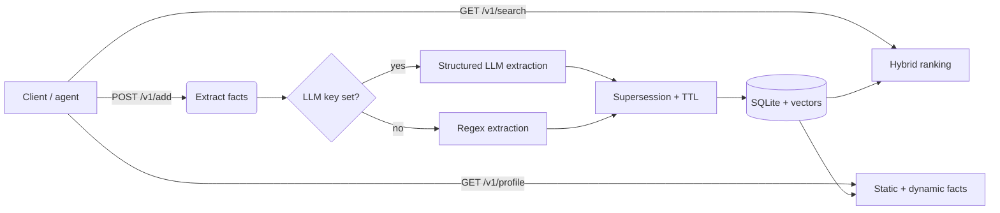

# Recall — self-hosted AI memory infrastructure

Recall is a small, self-contained memory engine for AI applications: it ingests raw
text, extracts durable and temporary facts, keeps them consistent over time (supersession
and expiry), and serves them back through hybrid semantic search and a user profile.

It is *memory infrastructure*, not a chatbot. A consuming agent or app calls Recall to
store what it learns and to retrieve relevant context, then uses that context when
generating a response.

The whole loop runs locally with **no external services or cloud keys required** for the
default path — local embeddings, a regex extractor fallback, and a single SQLite file.
Optional provider keys upgrade embeddings and extraction to hosted models.



## Why it exists

Hosted "memory" APIs make the core mechanics invisible. Recall implements the same
mechanics end-to-end in readable code so they can be studied, extended, and self-hosted:

- **Structured fact extraction** — an LLM (OpenAI / Anthropic / Gemini) emits typed facts
  through a JSON schema; a deterministic regex extractor keeps the app working offline.
- **Memory lifecycle** — slot-based supersession resolves contradictions ("I live in
  Berlin" → "I now live in Lisbon") and temporal keywords give temporary facts a TTL.
- **Semantic retrieval** — local `bge-base-en-v1.5` embeddings power hybrid search over
  both memories and the raw source documents.
- **Persistence** — a transactional SQLite backend (WAL) with explicit schema migrations
  and embeddings stored alongside each row.
- **Tenant-scoped API access** — hashed, scoped API keys with container ownership enforced
  in the data layer.

## Architecture

```
server.js                 Express app: routes, auth, tenant isolation, limits, shutdown
lib/auth.js               API-key issuance/hashing, auth middleware, container authorization
lib/validate.js           request / identifier / container / payload-size validation
lib/ratelimit.js          in-memory per-key rate limiter
lib/db.js                 compatibility shim → lib/storage
lib/storage/index.js      backend selection + facade (STORAGE_BACKEND)
lib/storage/sqlite.js     SQLite backend (better-sqlite3, WAL, transactions, indexes)
lib/storage/json.js       legacy JSON backend (kept for rollback)
lib/storage/migrations/   explicit SQL schema migrations (001 storage, 002 auth)
lib/storage/vectors.js    embedding encode/decode + validation
lib/extract.js            orchestrates LLM vs regex; applies slot/TTL mechanics
lib/extract/              openai / anthropic / gemini structured extractors + regex
lib/embeddings/           xenova (default) / openai / gemini / tfidf
lib/search.js             hybrid ranking over stored vectors
lib/tfidf.js              TF-IDF fallback scorer
public/                   vanilla HTML/CSS/JS dashboard (API-key field + authenticated calls)
scripts/                  key CLI, JSON→SQLite migration, and evaluation scripts
test/                     node:test regression suite
```

## How a memory flows through Recall

1. **Ingest** — `POST /v1/add` accepts raw text and stores the source document.
2. **Extract** — the text is classified into typed facts. With a provider key, an LLM
   returns structured JSON; otherwise the regex extractor runs. Each fact becomes a memory.
3. **Persist** — document and memories are written in a single transaction, with embeddings
   attached when the embedding provider is dense.
4. **Resolve** — a new fact in an existing *slot* (location, employer, editor, …) supersedes
   the older one; dynamic facts get an expiry derived from temporal keywords and are
   filtered out on read once expired.
5. **Retrieve** — `GET /v1/search` ranks memories + documents by vector cosine similarity
   (or TF-IDF when no dense provider is available); `GET /v1/profile` returns static
   (durable) and dynamic (temporary) facts.

## Quick start

```bash
npm install

# Bootstrap your first API key (offline CLI — shown once, then hashed):
npm run key:create -- --tenant alice --container my_space
#   API key created. This secret is shown ONCE — store it now.
#     sm_…
#     tenant:    alice
#     container: my_space

npm start
# open http://localhost:6767 and paste the key into the "api key" field
```

Requires **Node.js >= 20** (developed and tested on Node 23.11). Data is stored in SQLite
by default (`data/recall.db`).

On the first request with the default embedding provider, `bge-base-en-v1.5` (~100 MB) is
downloaded and cached. After that, search is local and key-free.

## Configuration

Copy `.env.example` to `.env` (never commit it) and adjust. Everything has a working
default; the variables below are the full surface.

| Variable | Default | Purpose |
|---|---|---|
| `PORT` | `6767` | HTTP port. |
| `DATA_DIR` | `./data` | Base directory for the database. |
| `STORAGE_BACKEND` | `sqlite` | `sqlite` (default) or `json` (legacy/rollback). |
| `SQLITE_FILE` / `STORE_FILE` | `data/recall.db` / `data/store.json` | Explicit file paths. |
| `AUTH_MODE` | `required` | `required`, or `dev` for a local single-tenant bypass. |
| `DEV_TENANT` / `DEV_CONTAINER` | `dev` / `dev` | Tenant/container used in `dev` mode. |
| `RATE_LIMIT_PER_MIN` | `120` | Per-key overall request budget. |
| `RATE_LIMIT_EXPENSIVE_PER_MIN` | `30` | Budget for embedding/LLM operations. |
| `CORS_ORIGINS` | *(off)* | Explicit comma-separated allowlist. Never a wildcard. |
| `EMBEDDINGS_PROVIDER` | `xenova` | `xenova` \| `openai` \| `gemini` \| `tfidf`. |
| `EMBEDDINGS_MODEL` | provider default | Override the embedding model id. |
| `EXTRACTION_PROVIDER` | `auto` | `auto` \| `openai` \| `anthropic` \| `gemini` \| `regex`. |
| `EXTRACTION_MODEL` | provider default | Override the extraction model id. |
| `OPENAI_API_KEY` / `ANTHROPIC_API_KEY` / `GEMINI_API_KEY` / `GOOGLE_API_KEY` | *(empty)* | Provider credentials. |

### API-key bootstrap

There is deliberately **no unauthenticated HTTP admin endpoint**. Use the offline CLI,
which talks to the same database:

```bash
# The first key: name a tenant and a container (the container is created/claimed).
npm run key:create -- --tenant alice --container demo_user --name "alice laptop"

# Existing-data migration: adopt a pre-existing container tag.
#   e.g. if your old tags were user_123 / demo_user, create keys with those --container values.
```

## Authentication and multi-tenancy

All `/v1` endpoints require a bearer API key:

```
Authorization: Bearer sm_…
```

- **Keys are hashed, never stored raw.** A key is `sm_` + 32 random bytes; only its SHA-256
  hash is persisted. The raw secret is shown **once**, when you create it.
- **Scoped keys.** Each key maps to exactly one `tenant` and one default `container`. The
  container named in a request (`?containerTag=…`) is a *selector*, never proof of ownership:
  you can only touch containers your tenant owns. Supplying a container that belongs to
  another tenant returns `403`, and so does a container you have never written to.
- **Ownership is enforced in the data layer** (`lib/storage`), not just in the routes, so a
  query cannot accidentally span containers.
- `/v1/containers` is authenticated and only ever returns *your* containers.

### Rotation and revocation

```bash
# List keys for a tenant (ids, container, created/last-used, revoked state — never the secret)
npm run key:list -- --tenant alice

# Create an additional key for the same tenant (rotation: issue new, then revoke old)
npm run key:create -- --tenant alice --container my_space

# Revoke by key id, or by presenting the raw key
npm run key:revoke -- --tenant alice --id key_xxx
npm run key:revoke -- --tenant alice --key sm_xxx
```

Revocation is immediate and tenant-scoped (one tenant can never revoke another's key).
Revoked and expired keys return `401`. A key may be created with `--expires 2027-01-01T00:00:00Z`.

### Local development mode

For local scripting without a key you may explicitly opt in:

```bash
AUTH_MODE=dev DEV_TENANT=dev DEV_CONTAINER=dev npm start
```

Dev mode maps **every** unauthenticated request to a single configured tenant/container and
prints a loud warning. It refuses to start when `NODE_ENV=production`. It is off unless you
set it — authentication is never silently bypassed.

### Rate limiting

Per-key request limits are enforced **in memory, in a single process** (defaults:
`RATE_LIMIT_PER_MIN=120` overall, `RATE_LIMIT_EXPENSIVE_PER_MIN=30` for the embedding/LLM
operations: `POST /v1/add`, `GET /v1/search`, and `GET /v1/profile` when a `q` is supplied).
Exceeding a limit returns `429` with a `Retry-After` header. Counters are not shared across
processes — see [Limitations](#limitations).

### CORS

CORS is **off by default** (the bundled dashboard is same-origin). To allow browser clients
from other origins, set an explicit allowlist — never a wildcard:

```bash
CORS_ORIGINS=https://app.example.com,https://admin.example.com npm start
```

## API

All endpoints require `Authorization: Bearer <key>`. `containerTag` is an optional selector
that must name a container your tenant owns; if omitted, the key's default container is used.
There is no implicit `demo_user` default.

```bash
KEY=sm_…   # from `npm run key:create`

# Add content — facts get extracted automatically
curl -X POST localhost:6767/v1/add -H "Authorization: Bearer $KEY" -H "Content-Type: application/json" \
  -d '{"content":"I am a backend engineer. I live in Berlin. I prefer Rust over Go.","containerTag":"user_123"}'

# Hybrid search (memories + documents). searchMode: hybrid | memories | documents
curl -H "Authorization: Bearer $KEY" "localhost:6767/v1/search?q=where+does+the+user+live&containerTag=user_123&searchMode=hybrid"

# User profile: static (durable) + dynamic (temporary) facts
curl -H "Authorization: Bearer $KEY" "localhost:6767/v1/profile?containerTag=user_123"

# All memories, including superseded/expired ones (for transparency/debugging)
curl -H "Authorization: Bearer $KEY" "localhost:6767/v1/memories?containerTag=user_123"

# Forget a memory
curl -X DELETE -H "Authorization: Bearer $KEY" "localhost:6767/v1/memories/<id>?containerTag=user_123"

# Your containers, and a self-description of the calling key
curl -H "Authorization: Bearer $KEY" localhost:6767/v1/containers
curl -H "Authorization: Bearer $KEY" localhost:6767/v1/whoami
```

Status codes: `400` validation error, `401` missing/invalid/revoked/expired key, `403`
container not owned by your tenant, `404` unknown id within an owned container, `413` payload
too large, `429` rate limited. Error bodies are generic (`{"error":"..."}`) and never leak
secrets or internals.

### Try contradiction resolution

```bash
KEY=sm_…

curl -X POST localhost:6767/v1/add -H "Authorization: Bearer $KEY" -H "Content-Type: application/json" \
  -d '{"content":"I live in Berlin.","containerTag":"user_123"}'

curl -X POST localhost:6767/v1/add -H "Authorization: Bearer $KEY" -H "Content-Type: application/json" \
  -d '{"content":"I now live in Lisbon instead.","containerTag":"user_123"}'

curl -H "Authorization: Bearer $KEY" "localhost:6767/v1/profile?containerTag=user_123"
# -> static facts show Lisbon only; GET /v1/memories shows Berlin marked "superseded"
```

## Storage

Recall keeps its data in SQLite (WAL mode) via [`better-sqlite3`](https://github.com/WiseLibs/better-sqlite3),
which ships a prebuilt native binary for common platforms (no compiler required). The REST
contract is unchanged — the storage backend sits behind `lib/storage/` and `lib/db.js` is a
thin compatibility shim.

| `STORAGE_BACKEND` | File | Notes |
|---|---|---|
| `sqlite` (default) | `data/recall.db` | Durable, transactional, single-file. |
| `json` | `data/store.json` | Legacy backend, kept for rollback. |

Environment: `DATA_DIR` (default `./data`), `SQLITE_FILE`, `STORE_FILE` override the paths.

Embeddings are stored as `Float64` BLOBs with provider/model/dimension metadata. Vectors are
validated on write and never truncated or reinterpreted. If the SQLite database is empty while
a legacy JSON store still holds data, the server logs a warning and **does not migrate
automatically**.

### Migrating from the JSON store

The migration is one-way and safe: it **never deletes or overwrites** `data/store.json`, backs
it up first, validates every record, writes in a single transaction and is idempotent on reruns.

```bash
# 1. Stop the app so it is not holding the database.
# 2. Preview what would happen (writes nothing):
npm run db:migrate-json -- --dry-run

# 3. Migrate (writes data/recall.db and backs up the source under data/backups/):
npm run db:migrate-json

# 4. Start as usual — SQLite is the default backend:
npm start
```

The command reports source/target document and memory counts, per-status counts, vector
dimensions and a final verification that every source id is present. Corrupt JSON, duplicate
ids, orphan memories (`documentId` with no parent) and malformed embeddings are reported by id
and block the migration (add `--allow-partial` to skip invalid rows). Memory content is never
printed.

### Backup and rollback

- **Backup:** with the app stopped, copy `data/recall.db` (and any `-wal`/`-shm` sidecars), or
  use `sqlite3 data/recall.db ".backup data/recall-backup.db"`. The migration command also
  stores a timestamped copy of the source JSON under `data/backups/`.
- **Rollback to JSON:** set `STORAGE_BACKEND=json` and restart. The original `data/store.json`
  is left intact by the migration, so this restores the previous behaviour exactly.
- The JSON store is never removed automatically; delete it yourself only after you are
  satisfied the SQLite data is correct.

## Embeddings

Set `EMBEDDINGS_PROVIDER` to choose how vectors are produced:

| Value | What it uses | Keys |
|---|---|---|
| `xenova` (default) | `@xenova/transformers` + `Xenova/bge-base-en-v1.5` | none |
| `openai` | `text-embedding-3-small` | `OPENAI_API_KEY` |
| `gemini` | `text-embedding-004` | `GEMINI_API_KEY` or `GOOGLE_API_KEY` |
| `tfidf` | lexical TF-IDF (fallback path) | none |

Optional: `EMBEDDINGS_MODEL` overrides the model id for the selected provider.

If the local Xenova model fails to load and you have not opted into a cloud provider, search
falls back to TF-IDF and the server logs that clearly.

```bash
# faster iteration while developing (needs a key)
EMBEDDINGS_PROVIDER=openai OPENAI_API_KEY=sk-... npm start
```

## Extraction

`POST /v1/add` classifies facts with an LLM when a key is present, then applies the same
slot-supersession and TTL rules as the regex path. With no key, regex runs so the app still
works offline.

| `EXTRACTION_PROVIDER` | What it uses | Keys |
|---|---|---|
| `auto` (default) | Anthropic, else OpenAI, else Gemini, else regex | first matching key |
| `openai` | `gpt-4o-mini` JSON schema | `OPENAI_API_KEY` |
| `anthropic` / `claude` | `claude-3-5-haiku-latest` tool use | `ANTHROPIC_API_KEY` |
| `gemini` | `gemini-2.0-flash` JSON schema | `GEMINI_API_KEY` or `GOOGLE_API_KEY` |
| `regex` | pattern rules in `lib/extract/regex.js` | none |

Optional: `EXTRACTION_MODEL` overrides the model id. If the LLM call fails, extraction falls
back to regex and logs a warning.

```bash
OPENAI_API_KEY=sk-... npm start
# or
EXTRACTION_PROVIDER=anthropic ANTHROPIC_API_KEY=... npm start
```

## Testing and evaluations

```bash
npm test                      # storage, migration, API, auth/isolation and shutdown tests
npm run eval:search           # paraphrase retrieval check (downloads the local model on first run)
npm run eval:extract          # regex-gap + structured-schema check (live LLM skipped without a key)
```

Tests use Node's built-in runner with temporary directories and never touch the real store.
They run with `EMBEDDINGS_PROVIDER=tfidf` and `EXTRACTION_PROVIDER=regex` for speed and
determinism; live model/LLM paths are exercised separately by the eval scripts.

The auth suite (`test/auth.test.js`) covers missing/malformed/invalid/revoked/expired keys,
cross-tenant reads/searches/profile/enumeration/deletes for **every** data route, IDOR via
known ids and forged container tags, hashing at rest, log redaction, rate limits, input
validation, the dev-mode production guard, the CLI bootstrap/revocation workflow and data
isolation after reopening the database. `test/auth-race.test.js` and a data-layer test cover
the container-claim race (see [Limitations](#limitations)).

## Limitations

Recall is a single-node, self-hosted engine. Known limits, stated honestly:

- **Single-process.** The SQLite backend keeps an in-memory mirror for the existing array read
  API. It is safe within one process (writes are committed synchronously), but it is **not
  multi-process consistent and not horizontally scalable**: two server processes sharing one
  database would each hold a stale mirror. Do not run more than one server process against a
  database.
- **Rate limiting is in-memory and per-process**, not distributed.
- **Brute-force vector scoring.** Search ranks vectors in memory rather than using an indexed
  vector store; fine for this scale, not for millions of rows.
- **Local/offline trust model.** Authentication and tenant isolation are enforced, but the app
  is intended to run on a trusted host behind your own network controls. Serve it over TLS and
  keep it off the public internet unless you have deliberately reviewed the deployment.
- **`npm audit` dependencies.** Five advisories (4 high, 1 critical) are reported, all
  transitive through `@xenova/transformers@2.17.2` (the latest published `@xenova` release):
  - `sharp@0.32.6` (high) — image codec (libvips/libheif/librsvg) issues. The text-only
    embedding path never exercises `sharp`.
  - `protobufjs@6.11.6` via `onnxruntime-web@1.14.0` → `onnx-proto@4.0.4` (critical) — protobuf
    code-generation/DoS issues reachable when deserializing ONNX model protobufs. This app only
    loads the trusted `Xenova/bge-base-en-v1.5` model; do not point `EMBEDDINGS_MODEL` at an
    untrusted model.

  There is **no non-breaking fix**: `npm audit fix --force` would downgrade
  `@xenova/transformers` to `1.4.2` (older and worse) or requires overriding `protobufjs@6`
  with `8.x` / `sharp` across a major version that `onnx-proto` and the native binaries do not
  support. The clean path is to migrate embeddings to `@huggingface/transformers` (the
  maintained successor, with newer `onnxruntime`/`sharp`). Until then these are documented, not
  silently ignored.

## Roadmap

Product-oriented next steps, roughly in order:

- **Migrate embeddings to `@huggingface/transformers`** — clears the transitive `npm audit`
  advisories and tracks the maintained runtime.
- **Indexed vector search** — move scoring out of memory (e.g. `sqlite-vec` or an external
  vector store) behind the existing `lib/storage` facade.
- **File ingestion** — accept documents/uploads and extract memory from them, not just raw text.
- **Connectors** — pull from Gmail, Drive, Notion, etc. as content sources.
- **MCP server / SDKs** — expose Recall to agents (Claude Desktop, editors) as a memory tool.
- **Shared, multi-process deployment** — a distributed rate limiter and a stateless read path
  so more than one process can serve the same database.

## Status

Functional and tested for the described scope: ingestion, extraction, persistence, retrieval,
authentication and tenant isolation. It is a focused engineering project, **not** a
production-hardened, horizontally-scaled service — see [Limitations](#limitations) before
exposing it.
